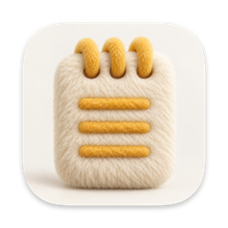
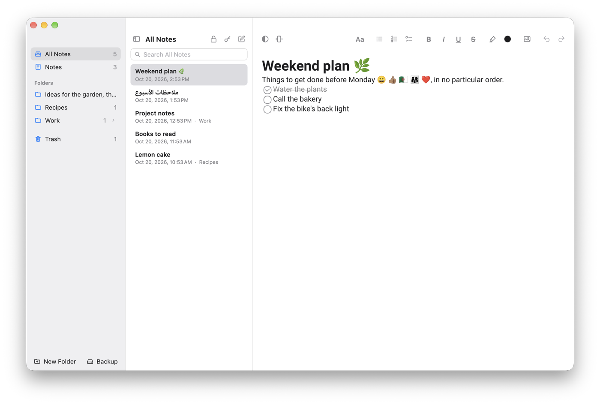
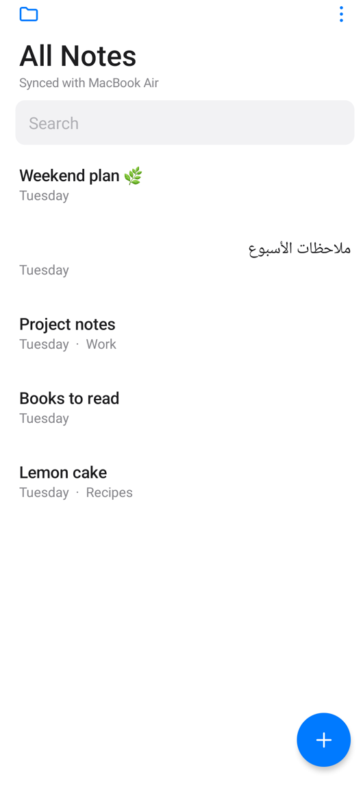
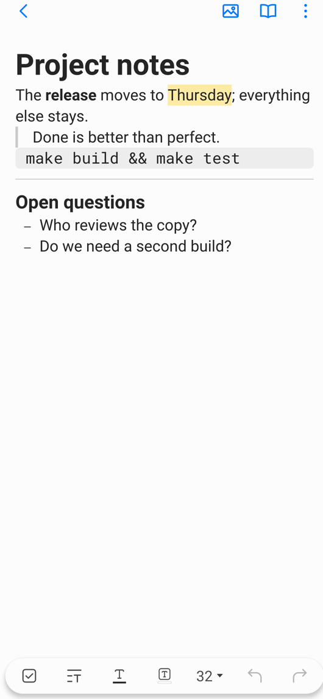
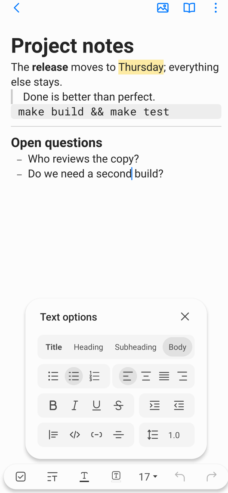

<p align="center">
  
</p>

# SyncedNotes

Encrypted notes for the Mac and an Android phone. No server, no account, no cloud: your notes
are locked with a passphrase only you know, and they go only between your own Mac and phone,
over your own network, never to Apple or Google.

<p align="center">
  
</p>

<p align="center">
  
  &nbsp;
  
  &nbsp;
  
</p>

**Version 0.2.0.** Both apps are written in Kotlin around one note engine of their own
(`shared/engine`, with its Rust half in `shared/glyphs`), which draws and edits the note
itself: no text view of Apple's, Google's or Compose's is involved. The Mac app is built
without Xcode; version 0.1.0 was a SwiftUI app, whose sources stay in the repo as reference
until the new one does everything it did. Not independently reviewed. What comes next is in
[`TODO.md`](TODO.md).

## What it does

- **Rich notes.** Titles, headings and subheadings; bulleted, dashed and numbered lists, nested;
  checklists; quotes, code blocks and inline code; dividers; pictures; bold, italic, underline
  and strikethrough; text colours and highlights; alignment, indents and line spacing. Arabic
  and other right-to-left text runs in its own direction, joined as it should be, with emoji in
  colour.
- **Code notes.** A code block can be in C or C++, and its syntax is coloured as an editor
  colours it: keywords, types, strings, numbers, comments, preprocessor lines and calls, in
  colours for the light look and the dark one. A comment or a raw string over many lines is
  coloured on every one of them.
- **Paste keeps the formatting** of what was copied from a web page (Claude, ChatGPT), from
  Notion, or as Markdown from a Copy button: headings, lists, checklists, quotes, code in its
  language, bold and the rest. ⌥⇧⌘V on the Mac, Ctrl+Shift+V on the phone, paste plain text.
- **Callouts.** Set lines apart on a coloured panel, blue, green, orange, purple, pink or gray,
  from the toolbar's callout button on the Mac or the swatches in the phone's Text options;
  inline code sits on a chip of its own. Coloured boxes pasted from a web page or Notion come in
  as callouts, and Markdown's `> [!NOTE]` alerts too.
- **Tables.** A table as Notion draws one, its columns as wide as their text, a shaded header
  row: from the toolbar's table button on the Mac (⌥⌘T) or the phone's Text options, with rows
  and columns added or taken away there. Tab and Return go from cell to cell. A table pasted
  from a web page, Notion, VS Code or Markdown comes in as a table.
- **A folder for your AI agent.** Share one folder with Claude Code, Claude Desktop or opencode,
  on your subscription, and the agent can read, change and add notes there through MCP, and see
  nothing else ([`Docs/AIAgents.md`](Docs/AIAgents.md)). It is the one way notes leave your
  devices, and only those in that folder.
- **The same tools on the Mac and the phone.** The phone's toolbar is Samsung Notes': checklist,
  a Text options card with every paragraph and character style, font colour, highlight, size,
  undo and redo, plus a picture button and reading mode. The Mac has the same in its toolbar,
  its Aa menu and the Format menu. Both offer the same colours, so a note looks the same on each.
- **Pictures** on a line of their own, inserted from a file on the Mac or the photo picker on the
  phone, shown at their size or the note's width, and synced locked.
- **A new note starts as its title.** Press Return and the body follows.
- **Folders, inside folders**, and **a Trash**, where deleted notes stay 30 days.
- **Search** over every word of every note, and **Find in Note** (⌘F on the Mac, ⋯ on the
  phone), which marks every match in the note and steps through them.
- **Light and dark**, or as the device is set, chosen on each.
- **Encrypted backups** to a file you choose, imported by adding to your notes or replacing them
  (what the backup lacks goes to the Trash), and a passphrase you can change at any time.

Not in the rebuilt app yet: a picture amid text (a note holding one opens read-only,
and is never saved over), pasting with formatting, dragging notes onto folders, and lists that
start as you type.

## The same notes on your phone

Pair the phone once: on the Mac, click the phone button beside the appearance button (or File >
Pair a Phone…); on the phone, tap Pair with your Mac. Check that both screens show the same
6-digit code, confirm on both, and type the Mac's passphrase on the phone. From then on, each
keeps the other's changes within moments whenever both are open and unlocked on the same
network; the phone button turns green while they are in step.

Nothing goes through the internet or any server: the two devices find each other on your
network and talk directly, over a connection only they can read, carrying notes that stay
locked with your passphrase on the way. Each note and folder keeps its latest version, deletions
included. How, byte by byte: [`Docs/Sync.md`](Docs/Sync.md).

## Your passphrase

The first time you open SyncedNotes, you choose a passphrase (or, on a new phone, pair it and use
the Mac's). You type it every time you open the app, and **there is no way to recover it**: no
copy of it is kept anywhere. Keep a backup (Backup at the bottom of the sidebar, or File >
Export Backup…) somewhere safe.

To change it, click the key above the list of notes, or File > Change Passphrase…. Every note
and picture is locked again with the new passphrase and checked before the old copy is
deleted, so stopping half way never loses anything. A paired phone asks for the new passphrase
the next time it connects. Backups made before the change still open only with the old one, so
export a new one afterwards.

Every passphrase field has an eye button to show what you typed.

## Keyboard shortcuts on the Mac

| | |
|---|---|
| New Note, New Folder | ⌘N, ⇧⌘N |
| Lock Notes | ⌃⌘L |
| Export Backup, Import Backup | ⇧⌘E, ⇧⌘I |
| Hide or Show the Sidebar | ⌃⌘S |
| Find in Note, Find Next, Find Previous | ⌘F, ⌘G, ⇧⌘G |
| Title, Heading, Subheading, Body | ⌥⌘1, ⌥⌘2, ⌥⌘3, ⌥⌘0 |
| Bulleted, Dashed, Numbered List | ⇧⌘7, ⇧⌘8, ⇧⌘9 |
| Checklist, Mark as Checked | ⇧⌘L, ⇧⌘U |
| Indent or outdent a list item | Tab, ⇧Tab |
| Block Quote, Insert Divider, Insert Picture | ⌘', ⇧⌘D, ⇧⌘P |
| Bold, Italic, Underline, Strikethrough | ⌘B, ⌘I, ⌘U, ⇧⌘X |
| Highlight | ⇧⌘H |
| Bigger, Smaller | ⌘=, ⌘− |
| Align Left, Center, Align Right | ⇧⌘[, ⇧⌘\\, ⇧⌘] |
| Increase Indent, Decrease Indent | ⌘], ⌘[ |
| Undo, Redo | ⌘Z, ⇧⌘Z |

## Privacy

Note content goes nowhere but your own Mac and phone, and Apple and Google are treated as
vendors like any other, not trusted:

- **On the Mac:** no iCloud, Siri, Apple Intelligence, Writing Tools, Dictation, AutoFill, Look
  Up, Translate, Share or Services, no Handoff or Universal Clipboard, no Spotlight indexing.
  Windows are kept out of screenshots and screen recording. The app runs in the App Sandbox,
  reaching only files you pick and the local network, for your phone; it is built and signed on
  the Mac without any Apple account.
- **On the phone:** no backup to Google, nothing handed to a new phone, no autofill or content
  capture, a keyboard told not to learn (Gboard and Samsung Keyboard show their incognito mark),
  and no note in screenshots or Recent apps.
- **Pictures** are written afresh before they are kept, so a photo's location, date and camera
  never enter a note.
- **No analytics, crash reporting or telemetry**, on either.

The full rule, how each part of it is kept, and the system settings to switch off yourself are
in [`Privacy.md`](Privacy.md). At rest, a note is locked twice: inside a database locked as a
whole, each note and picture is locked again on its own
([`Docs/LockFormat.md`](Docs/LockFormat.md) has every byte).

## Build and install

### The Mac app

Needs a JDK 25 or later and Rust (`cargo`), with Apple's Command Line Tools for the linker; no
Xcode. The build fetches everything else, the JDK the app carries included.

```bash
cd mac
./gradlew :app:makeTryNotes            # made-up notes to try the app on, SyncedNotes-Try
./gradlew :app:run -PtryUnlock         # the app on them, unlocked with their made-up passphrase
./gradlew :app:signApp                 # the app: mac/app/build/compose/binaries/main/app/SyncedNotes.app
```

A run from the build keeps its notes in `~/Library/Application Support/SyncedNotes-Try`, never
in the real ones. The installed app keeps its notes in its sandbox folder,
`~/Library/Containers/com.syncednotes.notes/Data/Library/Application Support/SyncedNotes`;
notes from the Swift app (`com.syncednotes.mac`) come across through a backup (File > Import
Backup…).

To install, quit SyncedNotes, replace the app in `/Applications`, and delete the build's copy,
so there is only one SyncedNotes on the Mac. The old app goes first: copied over it, the new one
would keep the old version's files beside its own, which breaks its signature. The notes are in
the sandbox folder above, not in the app, so replacing it leaves them as they are.

```bash
rm -rf /Applications/SyncedNotes.app
ditto mac/app/build/compose/binaries/main/app/SyncedNotes.app /Applications/SyncedNotes.app
rm -rf mac/app/build/compose/binaries/main/app/SyncedNotes.app
```

### The phone app

Needs the Android SDK command-line tools with platform 36 and NDK 28.2 (`ANDROID_HOME`), and
Rust's Android targets (`rustup target add aarch64-linux-android x86_64-linux-android`).

```bash
cd android
./gradlew :app:assembleDebug
adb install -r app/build/outputs/apk/debug/app-debug.apk
```

`./gradlew :app:assembleTryout` makes a second copy, "SyncedNotes Try", which installs beside
the real one with notes of its own, to try a change without touching yours. In `mac/`,
`./gradlew :app:run -PtryUnlock -PtryPairing` pairs the Mac's made-up notes with the first phone
whose pairing screen is open, accepting the code on the Mac's side.

## The project

| | |
|---|---|
| `mac/app` | The Mac app: Compose for Desktop windows around the note engine, the menus, Bonjour, and `KeepOnThisMac.kt` |
| `android/app` | The phone app: Android's own widgets around the note engine, after Samsung Notes |
| `shared/engine`, `shared/glyphs` | The note engine, for both apps: text, layout, editing and pictures in Kotlin; fonts, shaping and drawing in Rust |
| `shared/core` | Everything that is not on screen, for both apps: the lock, the encrypted database, folders, backups, changing the passphrase, and sync |
| `shared/core/Generated` | The note format's and sync's code, made from `SyncedNotesCore/Proto` |
| `shared/assets/fonts` | The fonts both apps ship, with their licences |
| `SyncedNotesCore/Proto/note.proto`, `sync.proto` | The note format, and what the phone and the Mac say to each other |
| `SyncedNotesCore/Fixtures/` | The lock's test files, written by the Swift app's lock code; the Kotlin lock must open them |
| `SyncedNotes/`, `SyncedNotesCore/`, `Vendor/GRDB` | The Swift app, kept for reference until the new one does everything it did |
| `Docs/` | Why it is built the way it is: [`Architect.md`](Docs/Architect.md) for the apps, [`LockFormat.md`](Docs/LockFormat.md) for the encryption, byte for byte, [`Sync.md`](Docs/Sync.md) for syncing the phone and the Mac |
| `Scripts/` | The phone's launcher icon, from `Design/AppIcon-artwork.png` |
| `Privacy.md`, `TODO.md` | The privacy rule and how it is kept; what comes next |

Dependencies, each pinned to one version: Compose for Desktop 1.12.2 on the Mac; SQLite3
Multiple Ciphers through `io.github.willena:sqlite-jdbc` 3.53.4.0 on the Mac and SQLCipher for
Android 4.19.1 on the phone (both SQLCipher 4's format); Bouncy Castle 1.86 for Argon2id;
protobuf-javalite 4.36.2; kotlinx-coroutines 1.9.0. Encryption itself uses the platform's own
AES-256-GCM, ECDH and ECDSA, with HKDF written out in `Lock.kt`. The Rust half uses no crates.

### Tests

```bash
cd mac && ./gradlew test                  # the lock, store, backups, sync, the engine, the Mac app
cd shared/glyphs && cargo test --release  # fonts, shaping, drawing
```

The lock, the database, backups, folders, the Trash, changing the passphrase and sync, a Mac
and a phone pairing and syncing over loopback included (`shared/core`); the note engine
(`shared/engine`); and the Mac app's rules on the real engine and store (`mac/app`).

### Generated files

Never edited by hand. Made again with:

```bash
# The note format's and sync's Java code, after a change to a .proto (protoc 36.2, to match
# protobuf-javalite 4.36.2):
cd SyncedNotesCore/Proto && protoc --java_out=lite:../../shared/core/Generated note.proto sync.proto
```

The lock's test files were written by the Swift app's lock code (`swift run make-fixtures`); a
change to the lock format is a new format version, and its test files would be written by the
Kotlin lock.

## Roadmap

Pictures amid text and pasting with formatting come first; then automatic encrypted
backups, auto-lock on the Mac, find and replace, links, tags, export to Markdown and PDF, and
note history. The full list is in [`TODO.md`](TODO.md).

## License

MIT, see [`LICENSE`](LICENSE). The vendored GRDB keeps its own MIT license
([`Vendor/GRDB/LICENSE`](Vendor/GRDB/LICENSE)); the fonts keep theirs (Apache 2.0 and the SIL
Open Font License, listed in [`shared/assets/fonts/README.md`](shared/assets/fonts/README.md)).
