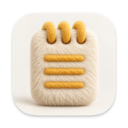

<p align="center">
  
</p>

# SyncedNotes

Encrypted notes for the Mac and an Android phone. No server, no account, no cloud: your notes
are locked with a passphrase only you know, and they go only between your own Mac and phone,
over your own network, never to Apple or Google.

**Version 0.2.0, being rebuilt.** Version 0.1.0 was a SwiftUI app; since 2026-10-22 the Mac
app is built without Xcode or Swift, in Kotlin, around the same note engine as the phone
app (`shared/engine`, with its Rust half in `shared/glyphs`), with the same design, the same
encrypted storage and the same backups. The Swift sources stay in the repo until the new app
does everything they did. Not independently reviewed. What comes next is in
[`TODO.md`](TODO.md).

Not back yet in the rebuilt app: pictures and tables (a note holding one opens read-only,
and is never saved over), rich copy and paste, dragging notes onto folders, typing `- ` or
`1. ` to start a list, and the Edit menu.

## What it does

- **Rich notes.** Titles, headings and body text; bulleted, numbered and dashed lists;
  checklists you can indent with Tab; tables; pictures; dividers; quotes and code; bold,
  italic, underline and strikethrough; highlights and text colours. Arabic and other
  right-to-left text runs in its own direction.
- **A new note starts as its title.** Press Return and the body follows.
- **The same tools on the Mac and the phone**: paragraph styles, four kinds of list,
  alignment, quotes, code, dividers, line spacing, the same text colours and highlights, and
  pictures (Insert Picture on the Mac, the picture button on the phone).
- **Folders, inside folders.** Drag notes onto a folder, or right-click a note and choose
  Move To. Select several notes with ⌘-click or ⇧-click to move or delete them together.
- **A Trash.** Deleted notes stay there for 30 days and can be restored.
- **Search** over every word of every note, and **Find in Note** (⌘F) marking every match in
  the note open, on the Mac and the phone alike.
- **Paste from anywhere.** Text pasted from a web page or another app takes the note's own
  font, size and colour, keeping bold, italic, lists and pictures. Copying between notes keeps
  everything. A picture can be clicked, copied, and pasted into other apps.
- **Light and dark mode**, with text that stays readable when the Mac switches between them.
- **Encrypted backups** to a file you choose, imported by adding to your notes or replacing
  them (what the backup lacks goes to the Trash), and a passphrase you can change at any time.
- **The same notes on your phone.** Pair the Android app once (File > Pair a Phone… on the
  Mac, or the phone button beside the appearance button; Pair with your Mac on the phone;
  then check that both show the same code); from then
  on each keeps the other's changes whenever both are open on the same network. Nothing goes
  through the internet ([`Docs/Sync.md`](Docs/Sync.md)).

## Your passphrase

The first time you open SyncedNotes, you choose a passphrase. You type it every time you open
the app, and **there is no way to recover it**: no copy of it is kept anywhere. Keep a backup
(the Backup menu at the bottom of the sidebar, or File > Export Backup…) somewhere safe.

To change it, click the key in the toolbar, or use Settings (⌘,) or File > Change Passphrase….
Every note and picture is locked again with the new passphrase and checked before the old
copy is deleted, so stopping half way never loses anything. Backups made before the change
still open only with the old passphrase, so export a new one afterwards.

Every passphrase field has an eye button to show what you typed.

## Keyboard shortcuts

| | |
|---|---|
| New Note, New Folder | ⌘N, ⇧⌘N |
| Lock Notes | ⌃⌘L |
| Export Backup, Import Backup | ⇧⌘E, ⇧⌘I |
| Title, Heading, Subheading, Body | ⌥⌘1, ⌥⌘2, ⌥⌘3, ⌥⌘0 |
| Bulleted, Dashed, Numbered List | ⇧⌘7, ⇧⌘8, ⇧⌘9 |
| Checklist, Mark as Checked | ⇧⌘L, ⇧⌘U |
| Indent or outdent a list or checklist item | Tab, ⇧Tab |
| Table, Block Quote | ⌥⌘T, ⌘' |
| Bold, Italic, Underline, Strikethrough | ⌘B, ⌘I, ⌘U, ⇧⌘X |
| Highlight, Show Colors | ⇧⌘H, ⇧⌘C |
| Bigger, Smaller | ⌘+, ⌘− |
| Align Left, Center, Align Right | ⌘{, ⌘\|, ⌘} |
| Increase Indent, Decrease Indent | ⌘], ⌘[ |

Lists also start as you type: `- `, `* ` or `1. ` at the start of a line.

## Privacy

Note content never leaves the Mac, and Apple is treated as a vendor like any other, not
trusted: no iCloud, no Siri or Apple Intelligence, no Writing Tools, no Dictation or AutoFill,
no Look Up, Translate, Share or Services, no Handoff or Universal Clipboard, no Spotlight
indexing, no analytics or crash reporting. Windows are kept out of screenshots and screen
recording, so the app shows blank in a screenshot. The app runs in the App Sandbox with no
network access, so macOS itself stops it connecting anywhere, and it is built and signed on
the Mac without any Apple account. The full rule, how each part of it is kept, and the system
settings to switch off yourself are in [`Privacy.md`](Privacy.md).

Your notes live in the app's own sandbox folder,
`~/Library/Containers/com.syncednotes.notes/Data/Library/Application Support/SyncedNotes` (the
Swift app's were under `com.syncednotes.mac`), in a database locked as a whole, holding each
note and picture locked again on its own ([`Docs/LockFormat.md`](Docs/LockFormat.md) has every
byte).

## Build and install

Needs a JDK 25 or later and Rust (`cargo`), with Apple's Command Line Tools for the linker;
no Xcode. The build fetches everything else, the JDK the app carries included.

```bash
cd mac
./gradlew :app:run                     # try the app on notes of its own, SyncedNotes-Try
./gradlew :app:signApp                 # the app: mac/app/build/compose/binaries/main/app/SyncedNotes.app
```

A run from the build keeps its notes in `~/Library/Application Support/SyncedNotes-Try`,
never in the real ones. `./gradlew :app:makeTryNotes` fills that folder with made-up notes,
and `./gradlew :app:run -PtryUnlock` opens them without typing their made-up passphrase.

The installed app keeps its notes in its own sandbox folder,
`~/Library/Containers/com.syncednotes.notes/Data/Library/Application Support/SyncedNotes`,
apart from the Swift app's (`com.syncednotes.mac`). Notes come across through a backup:
export one from the old app, import it in the new (File > Import Backup…).

To install, quit SyncedNotes, copy the app to `/Applications`, and delete the build's copy,
so there is only one SyncedNotes on the Mac:

```bash
ditto mac/app/build/compose/binaries/main/app/SyncedNotes.app /Applications/SyncedNotes.app
rm -rf mac/app/build/compose/binaries/main/app/SyncedNotes.app
```

### The phone app

Needs the Android SDK command-line tools with platform 36 and NDK 28.2 (`ANDROID_HOME`), and
Rust's Android targets (`rustup target add aarch64-linux-android x86_64-linux-android`).

```bash
cd android
./gradlew :app:assembleDebug
adb install -r app/build/outputs/apk/debug/app-debug.apk
```

`./gradlew :app:run -PtryUnlock -PtryPairing` in `mac/` pairs the try-out notes with the
first phone whose pairing screen is open, accepting its code on the Mac side, to try sync on
made-up notes.

## The project

| | |
|---|---|
| `mac/app` | The Mac app: Compose for Desktop windows around the note engine, the menus, and `KeepOnThisMac.kt` |
| `shared/core` | Everything that is not on screen, for both apps, tested from the terminal: the lock, the encrypted database, folders, backups, changing the passphrase |
| `shared/core/Generated` | The note format's code, made from `SyncedNotesCore/Proto/note.proto` |
| `shared/engine`, `shared/glyphs` | The note engine, for both apps: text, layout and editing in Kotlin, fonts and drawing in Rust |
| `shared/assets/fonts` | The fonts both apps ship |
| `android/app` | The phone app |
| `SyncedNotesCore/Proto/note.proto`, `sync.proto` | The note format, and what the phone and the Mac say to each other |
| `SyncedNotesCore/Fixtures/` | The lock's test files, written by the Swift app's lock code; the Kotlin lock must open them |
| `SyncedNotes/`, `SyncedNotesCore/`, `Vendor/GRDB` | The Swift app, kept for reference until the new one does everything it did |
| `Docs/` | Why it is built the way it is: [`Architect.md`](Docs/Architect.md) for the app, [`LockFormat.md`](Docs/LockFormat.md) for the encryption, byte for byte, [`Sync.md`](Docs/Sync.md) for syncing the phone and the Mac |
| `Privacy.md`, `TODO.md` | The privacy rule and how it is kept; what comes next |

Dependencies, each pinned to one version: Compose for Desktop 1.12.2, SQLite3 Multiple
Ciphers through `io.github.willena:sqlite-jdbc` 3.53.4.0 on the Mac (SQLCipher 4's format), Bouncy Castle
1.86 for Argon2id, and protobuf-javalite 4.36.2. Encryption itself uses the JDK's AES-256-GCM
and HKDF.

### Tests

```bash
cd mac && ./gradlew test
```

The lock, the database, backups, folders, the Trash and changing the passphrase (`shared/core`,
the Swift app's tests, ported), the note engine (`shared/engine`), and the app: reading and
writing notes exactly, and the window's rules on the real engine and store (`mac/app`).

### Generated files

Never edited by hand. Made again with:

```bash
# The note format's Java code, after a change to note.proto (protoc 36.2, to match
# protobuf-javalite 4.36.2):
cd SyncedNotesCore/Proto && protoc --java_out=lite:../../shared/core/Generated note.proto sync.proto
```

The lock's test files were written by the Swift app's lock code (`swift run make-fixtures`);
a change to the lock format is a new format version, and its test files would be written by
the Kotlin lock.

## Roadmap

Automatic encrypted backups, auto-lock and Touch ID come first; then find and replace, links,
tags, export to Markdown and PDF, and note history. An iPhone app is further off. The full list is in [`TODO.md`](TODO.md).

## License

MIT, see [`LICENSE`](LICENSE). The vendored GRDB keeps its own MIT license
([`Vendor/GRDB/LICENSE`](Vendor/GRDB/LICENSE)).
